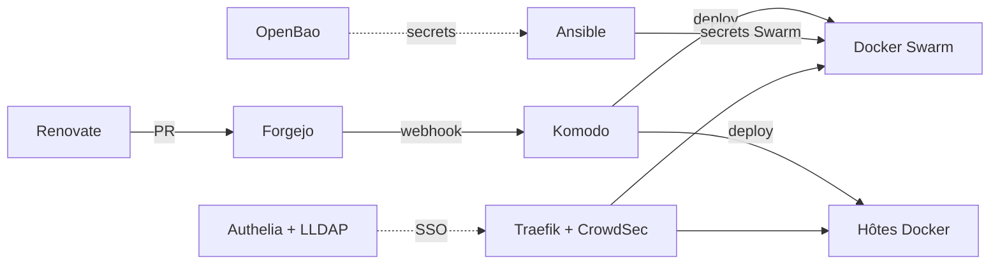

# Les services de mon homelab avec Docker

Les stacks de mon homelab : une vingtaine de services self-hosted, sur un
cluster Docker Swarm et quelques hôtes Docker. Déployés par Komodo, secrets dans
OpenBao, SSO avec Authelia.

C'est le quatrième maillon de ma chaîne d'automatisation : Packer construit
l'image, OpenTofu provisionne les machines, Ansible les configure, ce dépôt
déploie les services.

## Contenu de ce dépôt

- **GitOps** : un push sur `main` déclenche un webhook vers Komodo, qui sync sa
  configuration et redéploie les stacks modifiées.
- **Komodo as code** : serveurs, stacks, procédures et alerters en TOML.
- **Aucun secret dans le dépôt** : OpenBao en source, Ansible crée les secrets
  Swarm, versionnés pour la rotation.
- **SSO partout** : Authelia et LLDAP, en OIDC ou en forward auth, avec 2FA.
- **Exposition au cas par cas** : LAN only ou internet, derrière Traefik et
  CrowdSec.
- **Images pinnées par digest**, mises à jour par Renovate.

## Architecture

## Mes choix

- **Swarm avant Kubernetes** : maîtriser les bases à fond avant de passer à k3s,
  k8s, Talos etc.
- **Des secrets immuables** : une nouvelle valeur, c'est un nouveau nom (`_v2`).
- **Le SSO ne dépend pas de lui-même** : LLDAP, OpenBao et les managers Swarm
  restent accessibles sans Authelia.
- **Rollback automatique** : un service qui ne démarre pas revient seul à sa
  version précédente.

## Organisation

- `<stack>/` : un dossier par stack, son `compose.yaml` et sa configuration
- `komodo/` : la configuration de Komodo
- `_shared/` : les scripts communs à plusieurs stacks
- `.forgejo/workflows/` : la CI

## Pour aller plus loin

- [Stacks](docs/stacks.md) : rôle, hôte et exposition de chaque stack
- [Déploiement](docs/deploiement.md) : du push au conteneur, CI, Renovate
- [Secrets](docs/secrets.md) : d'OpenBao au conteneur, rotation
- [Accès](docs/acces.md) : Traefik, réseaux, SSO, CrowdSec

## Licence

[MIT](LICENSE)
